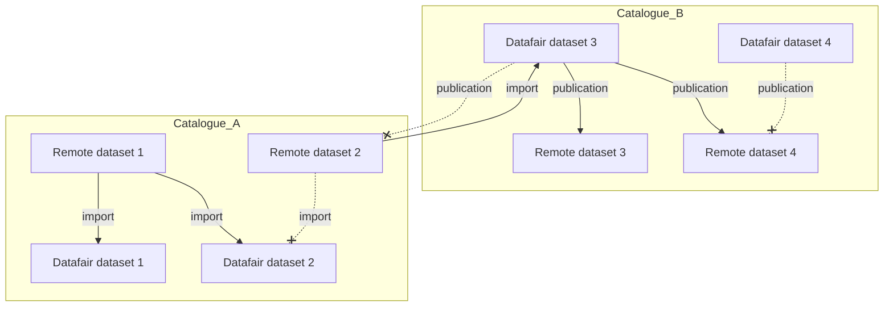

# Contribution guidelines

## Prerequisites

- A Javascript/Typescript IDE with [Vue.js](https://vuejs.org/) and [ESLint](https://marketplace.visualstudio.com/items?itemName=dbaeumer.vscode-eslint) support.
- A recent [Docker](https://docs.docker.com/engine/install/) installation.
- [Node.js 24.22.1+](https://nodejs.org/) (`.nvmrc`)

## Install dependencies

```sh
npm ci
npx playwright install chromium  # browser of the end-to-end tests
```

## Start the development environment

```sh
npm run dev                          # core containers, then the api, the worker and the ui
npm run dev -- --profile agents      # with the optional agents container
```

`npm run dev` copies `dev/default.env` to `.env` the first time (fixed ports 5800-5812; `.env` overrides them
and is never overwritten), builds the types and the UI once, starts the containers, then the api, the worker and
the ui in the terminal. Ctrl+C stops them. The dev page is at `http://localhost:5800/catalogs/dev`, the process
logs in `dev/logs/`. `npm run dev-deps` starts only the containers; `npm run dev:api`, `dev:worker` and `dev:ui`
run one process each, with the variables of `.env` exported.

## Stop the development environment

Ctrl+C, then:

```sh
npm run stop-dev-deps
```

## Building the Docker images

```sh
docker build --progress=plain --target=main -t data-fair/catalogs:dev .
docker build --progress=plain --target=worker -t data-fair/catalogs/worker:dev .
```

## Running the tests

The test suite uses [Playwright](https://playwright.dev/) and runs against the **running
dev environment** — the dev environment is the test environment. Start it first
(`npm run dev`), then :

```sh
npm test            # all tests (unit + api + e2e)
npm run test-unit   # unit tests only (no running services needed)
npm run test-api    # API tests only
npm run test-e2e    # browser e2e tests only
```

To run a specific file :

```sh
npx playwright test tests/features/plugins/registry.api.spec.ts
```

Tests live under `tests/features/<topic>/<name>.{unit,api,e2e}.spec.ts`. They own the
`test_catalogs_` accounts, seeded in simple-directory from `tests/support/sd-fixtures.ts`, and reset only
what those accounts own; the dev world `test_demo_` (`npm run dev-world`, login `test_demo_dev@example.org` /
`passwd`) and interactive data under other accounts are left untouched.

## Setup the development environment

> To work on the dataset publication feature, you first need to add a publication site and setup an API Key on Data Fair.

*Note : the snippets below use `http://localhost:5800` as the Data Fair URL (`NGINX_PORT` of `.env`).*

A. Congifure the publication site

You can configure the publication site for each organization on which you want to run your tests.

Here is the command to type in the browser console, while being connected as a super administrator (`test_demo_dev@example.org` / `passwd` of the dev world, in admin mode):

```js
fetch('http://localhost:5800/data-fair/api/v1/settings/user/test_demo_dev/publication-sites', {
  method: 'POST',
  headers: { 'Content-Type': 'application/json' },
  body: JSON.stringify({
      "type": "back-office",
      "id": "data-fair",
      "title": "Back Office",
      "url": "http://koumoul.com/data-fair",
      "datasetUrlTemplate": "http://koumoul.com/data-fair"
    })
})
```

*You can replace in the URL the type (user/organization) and the account ID to configure (here test_demo_dev)*

B. Configure the API Key

In the browser console, while being connected as a super administrator, you can create an API key used by the worker to import datasets and read metadata of datasets from the Data Fair API.

```js
fetch('http://localhost:5800/data-fair/api/v1/settings/user/test_demo_dev', {
  method: 'PUT',
  headers: { 'Content-Type': 'application/json' },
  body: JSON.stringify({
    "apiKeys": [{
      "title": "Catalogs",
      "scopes": ["datasets"],
      "adminMode": true,
      "asAccount": true
    }]
  })
})
.then(response => response.json())
.then(data => console.log(data.apiKeys[0].clearKey))
.catch(error => console.error('Erreur:', error));
```

Then copy the `clearKey` value returned by the API into `.env`, and restart the worker:

```sh
DATA_FAIR_API_KEY=your api key here
```

Without it, the worker uses the key of the last test run (AGENTS.md, "The worker's data-fair key").

## Random information

<details>
<summary>Expand...</summary>

### package.json scripts description

- `"prepare": "husky || true"` : Initializes Husky hooks before the first `npm install`. The `|| true` ensures the command doesn't fail if Husky is not installed or encounters an error.

</details>

## Permissions rules

- Only admin and superadmins can create, read, update and delete catalogs.
- Only admin and superadmins can import or publish datasets.

- In the UI, if we have the right to see a catalog, but the active account is not the same as the owner, an alert is shown to the user to inform him to change the active account.
- Plugins are available for all admins users !

### Permissions Matrix to create/edit/delete catalogs

*How to read : A user in (organization/department) (can/cannot) create/edit a catalog in (organization/department) level*

| User Level | Permission | Catalog Level |
|------------|--------------|------------|
| Organization | ✅ Can | Organization |
| Organization | ✅ Can | Department |
| Department | ❌ Cannot | Organization |
| Department | ✅ Can | Department |

### Permissions to import datasets

- For the moment, the owner of the imported dataset must be the same as the owner of the catalog.
- An organization admin can import datasets from any catalog, including those owned by a department.
- A department admin can only import datasets from catalogs owned by the same department.

### Permissions Matrix to publishing datasets

| Dataset Level | Catalog Level | User Level | Permission | Comments |
|------------|------------|--------------|------------|-|
| Organization | Organization | Organization | ✅ Allowed | |
| Organization | Organization | Department | ❌ Forbidden | |
| Organization | Department | Organization | ❌ Forbidden | |
| Organization | Department | Department | ❌ Forbidden | |
| Department | Organization | Organization | ✅ Allowed | |
| Department | Organization | Department | ❓ Ask admin | TODO: For the moment, this is just forbidden |
| Department | Department | Organization | ✅ Allowed | |
| Department | Department | Department | ✅ Allowed | |

## Possible relations between Remote datasets and Datafair datasets


